  <picture>
    <source media="(prefers-color-scheme: dark)" srcset="./assets/workbench/title-dark.svg">
    
  </picture>

  
  
  

<h2>把灵感做成可交互的产品 Ideas into products</h2>

我是 **Ethan Chen / 陈奕恺**，在杭州学习与开发，专注 **AI 应用、全栈开发与交互设计**。关注产品从想法到落地的完整过程：理解需求、组织系统、打磨体验，并完成实现与交付。

作品包括 **名笺**、**GitHub Trending Digest**、**EduCanvas** 与 **ForgeSight**，以及探索视觉表达与交互体验的 [个人网站](https://cyk-personal.xyz)。持续探索 AI 在产品与开发中的应用，让技术能力转化为清晰、可靠、可使用的作品。

*Exploring the intersection of AI, software engineering, and interaction design.*

> **近期关注 / Now** 
> AI Coding 工作流、Agent 产品、前端交互，以及把完整功能交付给真实用户。

<h2>项目工作台 Selected work</h2>

项目概念动画 · 功能与交互的视觉表达。

<table>
<tr>
<td width="50%" valign="top">

<h3><a href="https://github.com/Timcai06/EduCanvas">EduCanvas</a> 个人 Agent 与学习空间</h3>

面向学习与创作，把资料、对话、Canvas 和工具调用组织在同一空间，提供多模态交互与桌面助手。

覆盖桌面助手、语音交互、文件预览、账号与历史记录，以及评测、可观测性和开发体验。

<code>TypeScript</code> <code>Electron</code> <code>Agent</code>

<a href="https://github.com/Timcai06/EduCanvas"><kbd>仓库 ↗</kbd></a> <a href="https://github.com/Timcai06/EduCanvas/pulls?q=is%3Apr+author%3Asky-k111"><kbd>开发记录 ↗</kbd></a>

</td>
<td width="50%" valign="top">

<h3><a href="https://github.com/sky-k111/forge-sight">ForgeSight</a> 企业数据智能问析</h3>

面向制造业业务分析，以自然语言连接业务知识、指标口径、SQL 查询与可追溯证据。

提供经营看板、智能建模、Agent 报告与 PDF / Excel 导出、异常监测，以及安全执行与多租户隔离。

<code>React</code> <code>FastAPI</code> <code>LangGraph</code>

<a href="https://github.com/sky-k111/forge-sight"><kbd>仓库 ↗</kbd></a>

</td>
</tr>
<tr>
<td width="50%" valign="top">

<h3><a href="https://github.com/sky-k111/ai-name">名笺</a> AI 智能取名</h3>

根据偏好生成名字，结合多轮调整、寓意分析和名字比较，帮助用户理解并选择适合的名字。

覆盖前后端、模型接入、账号与配额、收藏与历史、管理工作区，以及响应式交互和 Docker 部署。

<code>Vue</code> <code>FastAPI</code> <code>DeepSeek</code>

<a href="https://github.com/sky-k111/ai-name"><kbd>仓库 ↗</kbd></a>

</td>
<td width="50%" valign="top">

<h3><a href="https://github.com/sky-k111/my-profile-v5">Portfolio V5</a> 个人网站与前端作品集</h3>

用一个可以浏览和交互的空间，展示个人介绍、项目和联系方式。

探索 Three.js 视觉、开场序列、GSAP 动效与页面转场，把产品与个人表达融入前端体验。

<code>React</code> <code>TypeScript</code> <code>Three.js</code> <code>GSAP</code>

<a href="https://cyk-personal.xyz"><kbd>cyk-personal.xyz ↗</kbd></a> <a href="https://github.com/sky-k111/my-profile-v5"><kbd>仓库 ↗</kbd></a>

</td>
</tr>
<tr>
<td width="50%" valign="top">

<h3><a href="https://github.com/sky-k111/homepage">Personal Homepage</a> 网页视觉与交互实践</h3>

个人主页与绘图页面，围绕介绍、技能、项目和联系信息组织页面叙事。

探索滚动动效、视觉编排与交互细节，在前端实践中把内容变成可浏览的体验。

<code>HTML</code> <code>CSS</code> <code>JavaScript</code> <code>GSAP</code>

<a href="https://github.com/sky-k111/homepage"><kbd>仓库 ↗</kbd></a>

</td>
<td width="50%" valign="top">

<h3><a href="https://github.com/sky-k111/translation">Translation</a> 网页翻译与词汇学习</h3>

在网页阅读过程中连接划词翻译、生词管理、闪卡、拼写练习与间隔复习。

关注翻译后的学习体验、浏览器交互和词汇管理，让查询之后的单词继续进入学习过程。

<code>Chrome Extension</code> <code>JavaScript</code> <code>React</code>

<a href="https://github.com/sky-k111/translation"><kbd>仓库 ↗</kbd></a>

</td>
</tr>
<tr>
<td width="50%" valign="top">

<h3><a href="https://github.com/sky-k111/gh-trending-digest">GitHub Trending Digest</a></h3>

用 AI 筛选开源项目，整理摘要并通过邮件推送。<b>项目正在升级中</b>，向个人早晚信息简报演进。

官方公告与 GitHub 来源、事件去重和 PDF / Word 预览已实现；偏好记忆、中文编辑与差异化早晚简报属于后续升级方向。

<code>Python</code> <code>GitHub Actions</code> <code>LLM</code>

<a href="https://github.com/sky-k111/gh-trending-digest"><kbd>仓库 ↗</kbd></a>

</td>
<td width="50%" valign="top">

<h3><a href="https://github.com/sky-k111/adaptive-skill-router">Adaptive Workflow</a></h3>

探索如何改善 AI Coding 中机械套用流程、长任务重复工作与验证不足的问题。

依据证据与风险选择方法，保留有效成果，按需检查文件状态、发现能力并做场景评估。<b>仍在探索与评估中</b>。

<code>Skills</code> <code>AI Coding</code> <code>Evaluation</code>

<a href="https://github.com/sky-k111/adaptive-skill-router"><kbd>仓库 ↗</kbd></a>

</td>
</tr>
</table>

<h2>常用技术 Toolbox</h2>

| 前端与交互 | 后端与数据 | AI 与交付 |
| --- | --- | --- |
| TypeScript / JavaScript | Python / FastAPI / Node.js | LLM APIs / Agent / RAG |
| React / Vue / Tailwind CSS | PostgreSQL / MySQL / SQLite | Skills / MCP / LangGraph |
| Three.js / GSAP / Electron | API / Auth / SSE | Docker / GitHub Actions |
| 前端产品与桌面体验 | 数据、接口与业务功能 | pytest / Vitest / Playwright |

<b>开源参与 · OpenAI Codex</b>

在 [Issue #41657](https://github.com/openai/codex/issues/41657) 中反馈 Windows 历史记录不可见的问题：扫描 15 个源记录文件，发现两处重复序号案例，源记录仍然完整。分享了诊断证据，以及写入、序号管理、投影重建与回归验证方面的改进建议，供其他人参考；评论中也有 Windows / macOS 用户提供类似故障证据。

<h2>一起做点有用的东西 Let's build</h2>

欢迎带着 **AI 应用、网站与业务系统、桌面助手、浏览器扩展或自动化工具** 的开发需求来聊，也可以讨论已有项目的功能完善与部署。

  
  
  

**[1503794397@qq.com](mailto:1503794397@qq.com)** · [cyk-personal.xyz](https://cyk-personal.xyz) · [X @ykchenxxx](https://x.com/ykchenxxx)

来信可以简单介绍：你想解决的问题、期望的功能，以及大致时间安排。一个还没整理完整的想法，也可以作为讨论的起点。
